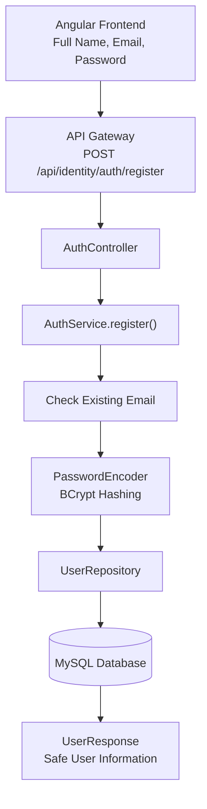
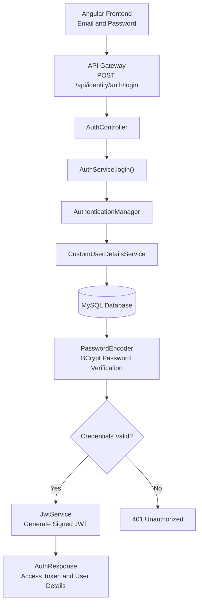
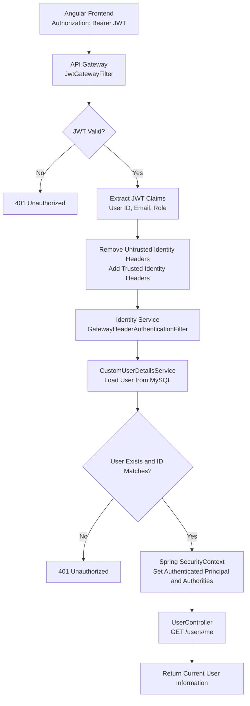

# FinLongevity – Microservices Setup

## Application Details

| Application | Port | URL | Purpose |
|---|---:|---|---|
| Discovery Server | 8010 | http://localhost:8010 | Eureka dashboard and service registry |
| Config Server | 8012 | http://localhost:8012/identity-service/default | Serves Identity Service configuration |
| Identity Service | 8080 | http://localhost:8080/health | Initial service health endpoint |
| API Gateway | 8082 | http://localhost:8082/actuator/health | API entry point and health endpoint |

## Start-up Order

Start the applications in the following order:

1. **Discovery Server** — http://localhost:8010
2. **Config Server** — http://localhost:8012
3. **Identity Service** — http://localhost:8080
4. **API Gateway** — http://localhost:8082

## Identity-service
In this service we added database-backed customer registration, BCrypt password hashing, login, JWT access-token generation, and a protected current-user endpoint.

## Endpoints

Direct Identity Service (port 8080):

- `POST http://localhost:8080/auth/register`
- `POST http://localhost:8080/auth/login`
- `GET http://localhost:8080/users/me` (requires Bearer token)

Through API Gateway (port 8082):

- `POST http://localhost:8082/api/identity/auth/register`
- `POST http://localhost:8082/api/identity/auth/login`
- `GET http://localhost:8082/api/identity/users/me` (requires Bearer token)

## Register request

```json
{
  "fullName": "Demo Customer",
  "email": "demo.customer@example.com",
  "password": "StrongPass123"
}
```

Expected: HTTP 201 Created, with user ID, name, email, role and creation time. The password is never returned.

## Login request

```json
{
  "email": "demo.customer@example.com",
  "password": "StrongPass123"
}
```

Expected: HTTP 200 with `accessToken`, `tokenType`, `expiresIn`, and safe user details.

# FinLongevity – Authentication & Security Flow

This document explains the authentication and security workflow implemented in FinLongevity, covering user registration, login, JWT generation, token validation and protected API access.

## 1. User Registration Flow

A new customer can create an account using their full name, email and password.

### Registration Architecture



### Registration Steps

1. Customer enters full name, email and password in the Angular frontend.
2. API Gateway forwards the registration request to Identity Service.
3. `AuthController` invokes `AuthService.register()`.
4. `AuthService` normalizes the email and checks whether the account already exists.
5. `PasswordEncoder` hashes the password using BCrypt.
6. `UserRepository` saves the new customer in MySQL.
7. `UserResponse` returns safe user information without exposing the password.

**Endpoint:** `POST /api/identity/auth/register`

---

## 2. User Login Flow

After registration, the customer can log in using their email and password.

### Login Architecture



### Login Steps

1. Customer submits their email and password.
2. API Gateway forwards the request to Identity Service.
3. `AuthService.login()` invokes `AuthenticationManager` to authenticate the credentials.
4. `CustomUserDetailsService` retrieves the customer details from MySQL.
5. `PasswordEncoder` verifies the submitted password against the stored BCrypt hash.
6. If authentication succeeds, `JwtService` generates a signed JWT containing the user's identity and role.
7. `AuthResponse` returns the access token, token type, expiration time and user details.

**Endpoint:** `POST /api/identity/auth/login`

---

## 3. Protected API Access Flow

After successful login, the customer receives a JWT and uses it to access protected APIs.

FinLongevity follows a centralized JWT validation approach in which the API Gateway validates incoming tokens before forwarding requests to downstream microservices.

### Authentication Architecture



### Protected API Access Steps

1. Angular sends the JWT in the `Authorization: Bearer` header.
2. `JwtGatewayFilter` validates the JWT signature, expiration and required claims.
3. If the token is valid, the Gateway extracts the user ID, email and role from the JWT.
4. Gateway removes caller-supplied identity headers and adds trusted identity headers.
5. `GatewayHeaderAuthenticationFilter` receives the request inside Identity Service.
6. `CustomUserDetailsService` loads the user from MySQL.
7. Identity Service verifies that the user ID from the Gateway matches the database user.
8. `SecurityContextHolder` stores the authenticated principal and authorities.
9. `UserController` processes the protected request and returns the current user's information.

**Example endpoint:** `GET /api/identity/users/me`

**Authorization:** Bearer Token Required

---

## 4. Trusted Identity Headers

After successful JWT validation, the API Gateway forwards authenticated user information to downstream services using trusted HTTP headers.

| Header | Example Value | Description |
|---|---|---|
| `X-Authenticated-User-Id` | `101` | Authenticated user's ID |
| `X-Authenticated-User-Email` | `rahul@gmail.com` | Authenticated user's email |
| `X-Authenticated-User-Role` | `CUSTOMER` | Authenticated user's role |

The Gateway removes any identity headers supplied by the original client before inserting validated values.

---

## 5. Security Components and Responsibilities

| Component | Responsibility |
|---|---|
| `AuthController` | Exposes registration and login endpoints |
| `AuthService` | Handles registration and login business logic |
| `AuthenticationManager` | Authenticates user credentials |
| `CustomUserDetailsService` | Loads user details from MySQL |
| `PasswordEncoder` | Performs BCrypt password hashing and verification |
| `JwtService` | Generates signed JWT tokens |
| `JwtGatewayFilter` | Validates JWT tokens at API Gateway |
| `GatewayHeaderAuthenticationFilter` | Establishes the authenticated principal using trusted Gateway headers |
| `SecurityConfig` | Configures endpoint access and Spring Security |
| `SecurityContextHolder` | Stores the current request's authentication information |

---

## 6. Authentication and Authorization Responses

| Scenario | HTTP Status | Description |
|---|---:|---|
| Successful registration | 200 OK | Customer account created |
| Duplicate email | 409 Conflict | Account already exists |
| Successful login | 200 OK | JWT generated |
| Invalid login credentials | 401 Unauthorized | Authentication failed |
| Missing JWT on protected endpoint | 401 Unauthorized | Authentication required |
| Invalid or expired JWT | 401 Unauthorized | Token rejected |
| User does not exist | 401 Unauthorized | Identity validation failed |
| Insufficient permissions | 403 Forbidden | Authenticated user lacks required authority |

---

## 7. Overall Security Architecture

FinLongevity separates authentication responsibilities across its microservices architecture:

- **Identity Service:** Manages customer registration, login, password security and JWT generation.
- **API Gateway:** Acts as the centralized entry point and validates JWT tokens for protected requests.
- **Gateway Identity Propagation:** Passes validated user identity to downstream services using trusted headers.
- **Spring Security:** Establishes the authenticated principal and enforces endpoint-level authorization.

**Design Approach:** Centralized JWT validation at the API Gateway with service-level Spring Security authentication and authorization.
