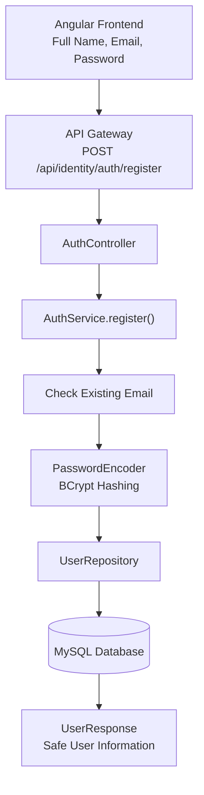
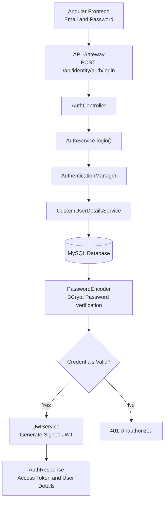
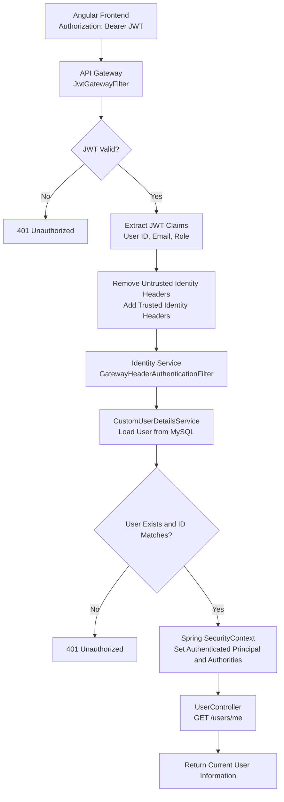

# FinLongevity – Microservices Setup

## Application Details

| Application      | Port | URL                                            | Purpose |
|------------------|-----:|------------------------------------------------|---|
| Discovery Server | 8010 | http://localhost:8010                          | Eureka dashboard and service registry |
| Config Server    | 8012 | http://localhost:8012/identity-service/default | Serves Identity Service configuration |
| Identity Service | 8080 | http://localhost:8080/health                   | Initial service health endpoint |
| API Gateway      | 8082 | http://localhost:8082/actuator/health          | API entry point and health endpoint |
| Customer service | 8081 | http://localhost:8081/actuator/health          | Initial service health endpoint  |

## Start-up Order

Start the applications in the following order:

1. **Discovery Server** — http://localhost:8010
2. **Config Server** — http://localhost:8012
3. **Identity Service** — http://localhost:8080
4. **API Gateway** — http://localhost:8082
5. **Customer Service** — http://localhost:8081

## Identity-service
In this service we added database-backed customer registration, BCrypt password hashing, login, JWT access-token generation, and a protected current-user endpoint.

## Endpoints

Direct Identity Service (port 8080):

- `POST http://localhost:8080/auth/register`
- `POST http://localhost:8080/auth/login`
- `GET http://localhost:8080/users/me` (requires Bearer token)

Through API Gateway (port 8082):

- `POST http://localhost:8082/api/identity/auth/register`
- `POST http://localhost:8082/api/identity/auth/login`
- `GET http://localhost:8082/api/identity/users/me` (requires Bearer token)

## Register request

```json
{
  "fullName": "Demo Customer",
  "email": "demo.customer@example.com",
  "password": "StrongPass123"
}
```

Expected: HTTP 201 Created, with user ID, name, email, role and creation time. The password is never returned.

## Login request

```json
{
  "email": "demo.customer@example.com",
  "password": "StrongPass123"
}
```

Expected: HTTP 200 with `accessToken`, `tokenType`, `expiresIn`, and safe user details.

# FinLongevity – Authentication & Security Flow

This document explains the authentication and security workflow implemented in FinLongevity, covering user registration, login, JWT generation, token validation and protected API access.

## 1. User Registration Flow

A new customer can create an account using their full name, email and password.

### Registration Architecture



### Registration Steps

1. Customer enters full name, email and password in the Angular frontend.
2. API Gateway forwards the registration request to Identity Service.
3. `AuthController` invokes `AuthService.register()`.
4. `AuthService` normalizes the email and checks whether the account already exists.
5. `PasswordEncoder` hashes the password using BCrypt.
6. `UserRepository` saves the new customer in MySQL.
7. `UserResponse` returns safe user information without exposing the password.

**Endpoint:** `POST /api/identity/auth/register`

---

## 2. User Login Flow

After registration, the customer can log in using their email and password.

### Login Architecture



### Login Steps

1. Customer submits their email and password.
2. API Gateway forwards the request to Identity Service.
3. `AuthService.login()` invokes `AuthenticationManager` to authenticate the credentials.
4. `CustomUserDetailsService` retrieves the customer details from MySQL.
5. `PasswordEncoder` verifies the submitted password against the stored BCrypt hash.
6. If authentication succeeds, `JwtService` generates a signed JWT containing the user's identity and role.
7. `AuthResponse` returns the access token, token type, expiration time and user details.

**Endpoint:** `POST /api/identity/auth/login`

---

## 3. Protected API Access Flow

After successful login, the customer receives a JWT and uses it to access protected APIs.

FinLongevity follows a centralized JWT validation approach in which the API Gateway validates incoming tokens before forwarding requests to downstream microservices.

### Authentication Architecture



### Protected API Access Steps

1. Angular sends the JWT in the `Authorization: Bearer` header.
2. `JwtGatewayFilter` validates the JWT signature, expiration and required claims.
3. If the token is valid, the Gateway extracts the user ID, email and role from the JWT.
4. Gateway removes caller-supplied identity headers and adds trusted identity headers.
5. `GatewayHeaderAuthenticationFilter` receives the request inside Identity Service.
6. `CustomUserDetailsService` loads the user from MySQL.
7. Identity Service verifies that the user ID from the Gateway matches the database user.
8. `SecurityContextHolder` stores the authenticated principal and authorities.
9. `UserController` processes the protected request and returns the current user's information.

**Example endpoint:** `GET /api/identity/users/me`

**Authorization:** Bearer Token Required

---

## 4. Trusted Identity Headers

After successful JWT validation, the API Gateway forwards authenticated user information to downstream services using trusted HTTP headers.

| Header | Example Value | Description |
|---|---|---|
| `X-Authenticated-User-Id` | `101` | Authenticated user's ID |
| `X-Authenticated-User-Email` | `rahul@gmail.com` | Authenticated user's email |
| `X-Authenticated-User-Role` | `CUSTOMER` | Authenticated user's role |

The Gateway removes any identity headers supplied by the original client before inserting validated values.

---

## 5. Security Components and Responsibilities

| Component | Responsibility |
|---|---|
| `AuthController` | Exposes registration and login endpoints |
| `AuthService` | Handles registration and login business logic |
| `AuthenticationManager` | Authenticates user credentials |
| `CustomUserDetailsService` | Loads user details from MySQL |
| `PasswordEncoder` | Performs BCrypt password hashing and verification |
| `JwtService` | Generates signed JWT tokens |
| `JwtGatewayFilter` | Validates JWT tokens at API Gateway |
| `GatewayHeaderAuthenticationFilter` | Establishes the authenticated principal using trusted Gateway headers |
| `SecurityConfig` | Configures endpoint access and Spring Security |
| `SecurityContextHolder` | Stores the current request's authentication information |

---

## 6. Authentication and Authorization Responses

| Scenario | HTTP Status | Description |
|---|---:|---|
| Successful registration | 200 OK | Customer account created |
| Duplicate email | 409 Conflict | Account already exists |
| Successful login | 200 OK | JWT generated |
| Invalid login credentials | 401 Unauthorized | Authentication failed |
| Missing JWT on protected endpoint | 401 Unauthorized | Authentication required |
| Invalid or expired JWT | 401 Unauthorized | Token rejected |
| User does not exist | 401 Unauthorized | Identity validation failed |
| Insufficient permissions | 403 Forbidden | Authenticated user lacks required authority |

---

## 7. Overall Security Architecture

FinLongevity separates authentication responsibilities across its microservices architecture:

- **Identity Service:** Manages customer registration, login, password security and JWT generation.
- **API Gateway:** Acts as the centralized entry point and validates JWT tokens for protected requests.
- **Gateway Identity Propagation:** Passes validated user identity to downstream services using trusted headers.
- **Spring Security:** Establishes the authenticated principal and enforces endpoint-level authorization.

**Design Approach:** Centralized JWT validation at the API Gateway with service-level Spring Security authentication and authorization.


# Customer Service – Authentication & Profile Management

## Overview

Customer Service is responsible for creating and managing customer profiles for users registered through Identity Service.

It does not perform independent user authentication, JWT validation, or identity verification. These responsibilities belong to Identity Service and API Gateway.

Customer Service trusts the authenticated identity context forwarded by API Gateway through HTTP headers.

## Authentication Architecture

```text
                 CLIENT
                   |
                   | Request with JWT
                   v
              API GATEWAY
                   |
                   | 1. Extract Bearer Token
                   | 2. Validate JWT Signature
                   | 3. Validate Token Expiration
                   | 4. Extract User Claims
                   |
                   | Forward Trusted Headers
                   |
                   | X-Authenticated-User-Id
                   | X-Authenticated-User-Email
                   | X-Authenticated-User-Role
                   v
             CUSTOMER SERVICE
                   |
                   | GatewayAuthenticationFilter
                   | 1. Read Identity Headers
                   | 2. Check Required Headers
                   | 3. Create Security Principal
                   | 4. Establish Security Context
                   |
                   v
             CUSTOMER PROFILE
                   |
                   | Create / Retrieve / Update
                   v
          FINANCIAL_CUSTOMER_DB
```

## Responsibilities

### 1. Identity Service

- Handles user registration and login.
- Validates user credentials.
- Stores user identity information.
- Generates JWT tokens after successful authentication.

### 2. API Gateway

- Acts as the entry point for client requests.
- Validates JWT signatures and expiration.
- Extracts authenticated user information from JWT claims.
- Removes untrusted identity headers supplied by clients.
- Adds trusted identity headers before forwarding requests to downstream services.

### 3. Customer Service

- Receives authenticated identity information from API Gateway.
- Does not validate JWT tokens independently.
- Does not access the Identity Service database.
- Creates customer profiles for authenticated identity users.
- Uses the authenticated user ID to associate a customer profile with its identity account.
- Manages customer profile information independently.

## Customer Profile Creation Flow

```text
1. User registers through Identity Service.
                |
                v
2. Identity Service creates the user account.
                |
                v
3. User logs in and receives JWT.
                |
                v
4. Client sends a profile creation request
   through API Gateway with the JWT.
                |
                v
5. API Gateway validates the JWT.
                |
                v
6. Gateway extracts userId, email and role.
                |
                v
7. Gateway forwards authenticated identity headers.
                |
                v
8. Customer Service GatewayAuthenticationFilter
   reads the identity headers.
                |
                v
9. SecurityContext is established.
                |
                v
10. Customer Service creates the customer profile
    using the authenticated user ID.
                |
                v
11. Profile is saved in financial_customer_db.
                |
                v
12. Successful response returned to the client.
```

## Identity Headers

API Gateway forwards the following headers:

| Header | Purpose |
|---|---|
| `X-Authenticated-User-Id` | Identifies the authenticated user |
| `X-Authenticated-User-Email` | Provides the user's email |
| `X-Authenticated-User-Role` | Provides the user's assigned role |

Customer Service uses these headers to establish the local Spring Security principal.

## Database Ownership

| Service | Database | Responsibility |
|---|---|---|
| Identity Service | `financial_identity_db` | User accounts, credentials and roles |
| Customer Service | `financial_customer_db` | Customer profiles and customer-related information |

The customer profile references the identity account using its user ID. Customer Service does not maintain a direct database relationship with Identity Service.

## Security Design

Customer Service follows a Gateway-based authentication model.

- JWT validation is centralized at API Gateway.
- Identity Service remains the owner of user accounts.
- Customer Service trusts identity headers inserted by the Gateway.
- Customer Service creates its own local SecurityContext.
- Missing authentication headers result in HTTP 401 Unauthorized.
- Customer Service is not intended to be directly accessible by external clients.

**Important:** Direct access to Customer Service must be restricted to trusted internal traffic. Otherwise, an external caller could forge identity headers and impersonate another user.

## Design Principle

**Identity Service establishes who the user is. API Gateway authenticates incoming requests. Customer Service manages the user's customer profile.**

This separation maintains clear service responsibilities and independent database ownership within the FinLongevity microservices architecture.

## now
Now implementing: payment modes for customer:
can have one full time employment and may have multiple side earning business


## Employment
- `PUT /api/customers/me/employment` — create or update one current employment record.
- `GET /api/customers/me/employment` — retrieve it.

Example:
```json
{
  "employmentType": "FULL_TIME",
  "employerName": "Example Technologies",
  "designation": "Software Engineer",
  "employmentStartDate": "2025-06-27",
  "employmentEndDate": null,
  "currentlyEmployed": true
}
```

## Income sources
- `POST /api/customers/me/income-sources` — add a source.
- `GET /api/customers/me/income-sources` — list the signed-in user's sources.
- `PUT /api/customers/me/income-sources/{id}` — update an owned source.
- `DELETE /api/customers/me/income-sources/{id}` — delete an owned source.

Example:
```json
{
  "incomeType": "SALARY",
  "sourceName": "Monthly Salary",
  "amount": 85000.00,
  "frequency": "MONTHLY",
  "currency": "INR",
  "active": true
}
```

now customer can add assets and his liabilities

now customer can add nominies
- Each nominee belongs to one authenticated identity user (identityUserId).

## Risk Tolerance :
"What kind of financial products and investment options are suitable for this customer's preferences and goals?"

customer declared: risk profile

This profile stores customer-declared preferences. It is not a regulated suitability assessment or a personalized investment recommendation.

This tells us about:Customer A – Conservative
Low risk preference
- Beginner investor
- Prefers Fixed Deposits and Bonds
- Objective: Capital preservation
- FinLongevity can prioritise showing lower-risk product options.


Customer B – Moderate
Medium risk preference
- Intermediate investor
- Prefers Mutual Funds and FDs
- Objective: Wealth creation
- FinLongevity can show a mix of product categories for comparison.


Customer C – Aggressive
Higher risk preference
- Experienced investor
- Interested in Stocks and Mutual Funds
- Objective: Long-term wealth creation
- FinLongevity can highlight products matching those declared preferences.

## Household & Family Members
This module currently manages the household owner's household and dependant records.


